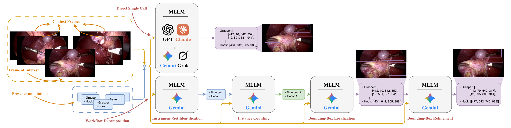
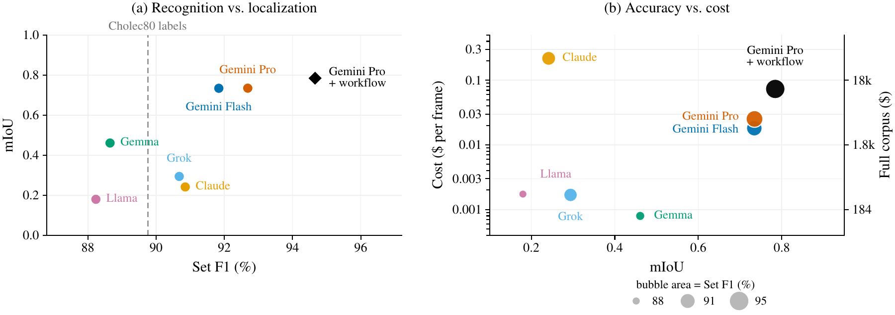

<h1 align="center">
  <picture>
    <source media="(prefers-color-scheme: dark)" srcset="assets/logo-dark.svg">
    
  </picture>
</h1>

<p align="center">
  <b>From Presence Labels to Bounding Boxes: Can Multimodal Large Language Models Scale Surgical Instrument Localization?</b><br>
  Mohamed Hamdy, Muraam Abdel-Ghani, Fatmaelzahraa Ahmed, Sifna Nasar, Mariam Ahmed, Khalid Al-Jalham, Abdulaziz Al-Ali, Shidin Balakrishnan<br>
  <i>MICAD 2026</i>
</p>

<p align="center">
  <a href="https://arxiv.org/abs/2610.34218"></a>
  <a href="https://huggingface.co/datasets/M-Hamdy/SurgBox"></a>
  <a href="https://huggingface.co/collections/M-Hamdy/surgbox-6ab26d3d369b6ae938463b44"></a>
</p>

<p align="center">Instance-level bounding boxes for surgical instruments in all 80 videos of Cholec80.</p>

Cholec80 annotates, once per second, which of seven instruments are present, but not where they are. SurgBox converts these presence labels into class-specific bounding boxes using a multi-stage multimodal LLM pipeline, and provides a 1,000-frame human reference, annotated twice and reviewed by a surgeon, for measuring localization quality.



| Videos | Frames | Boxes | Classes | Empty frames |
|:---:|:---:|:---:|:---:|:---:|
| 80 | 184,498 | 285,977 | 7 | 18,588 |

| Grasper | Bipolar | Hook | Scissors | Clipper | Irrigator | SpecimenBag |
|:---:|:---:|:---:|:---:|:---:|:---:|:---:|
| 139,464 | 9,010 | 103,495 | 4,164 | 6,708 | 11,295 | 11,841 |

## Contents

The annotations and detectors are on Hugging Face; this repository holds the code.

| | Hugging Face | |
|---|---|---|
| Dataset | [M-Hamdy/SurgBox](https://huggingface.co/datasets/M-Hamdy/SurgBox) | boxes for all 184,498 annotated frames, the 1,000-frame human reference and the splits |
| Detectors | [SurgBox collection](https://huggingface.co/collections/M-Hamdy/surgbox-6ab26d3d369b6ae938463b44) | the three detectors of Table 2 and the three of Table 3 (see [Pretrained detectors](#pretrained-detectors)) |

```
surgbox.py     the annotation pipeline
evaluate.py    set F1 and mIoU against a reference
demo.ipynb     loads the dataset and detectors from Hugging Face and draws their boxes on Cholec80 frames
```

The dataset and detectors are gated: accept the conditions on their pages and log in with `hf auth login`. The dataset loads with `load_dataset("M-Hamdy/SurgBox")` (see the [dataset card](https://huggingface.co/datasets/M-Hamdy/SurgBox)). To download the annotations in COCO format:

```bash
pip install huggingface_hub
hf download M-Hamdy/SurgBox --repo-type dataset --include "coco/*" --local-dir data
```

```
data/coco/
  surgbox.json.gz         boxes for all 184,498 annotated Cholec80 frames
  human/
    reference.json        1,000 frames, annotator 1 after surgeon review (the reference)
    annotator_1.json      1,000 frames, annotator 1 before review
    annotator_2.json      1,000 frames, annotator 2, independent pass
  splits.json             video-level splits used in the paper
```

## Format

The files are in COCO format. Each image carries its source video and frame:

```json
{"id": 1, "file_name": "video01/000000.png", "video": 1, "frame": 0, "width": 854, "height": 480}
```

`frame` is the frame index in the original 25 fps video, matching the `Frame` column of the Cholec80 tool annotations; frames are sampled at 1 fps. Boxes are `[x, y, width, height]` in pixels of the source video; videos 78, 79 and 80 are 1920×1080, all others 854×480. A box covers the visible extent of the instrument, shaft and tip, without completing occluded or out-of-frame parts. Some boxes (423 of 285,977) extend past the image border; before training, clip boxes to the image and drop any side shorter than 2 pixels, as in the detection benchmark of the paper. Boxes in `surgbox.json.gz` also carry the model's `confidence` (1–5).

The videos are not included. Request Cholec80 from [CAMMA](http://camma.u-strasbg.fr/datasets), then extract the annotated frames:

```python
import cv2, os

def extract(video, out_dir):
    os.makedirs(out_dir, exist_ok=True)
    cap, i = cv2.VideoCapture(video), 0
    while (ok := cap.read())[0]:
        if i % 25 == 0:
            cv2.imwrite(f"{out_dir}/{i:06d}.png", ok[1])
        i += 1

extract("video01.mp4", "video01")
```

## Human reference

The 1,000 frames span all 80 videos and are sampled from the Cholec80 labels to balance the seven classes, with 150 frames that have no instrument in the labels. Each frame was annotated by two annotators; the first annotation set was reviewed by a surgeon. In `reference.json`, `review` is `finalized` for the 984 frames the surgeon approved and `changes_requested` for 16 frames outside the laparoscopic view (e.g. out-of-body views), which have no boxes.

| | Set F1 (%) | mIoU | Matched mIoU |
|---|:---:|:---:|:---:|
| Annotator 2 vs. reference (human agreement) | 94.18 | 0.814 | 0.912 |
| Pipeline, evaluation run (paper, Table 1) | 94.66 | 0.784 | 0.857 |
| `surgbox.json.gz` (this release) | 94.42 | 0.774 | 0.852 |

The released corpus is a separate run of the same pipeline over all frames; the pipeline is stochastic, so it scores slightly differently on the reference than the evaluation run reported in the paper. Boxes are matched greedily within each class by IoU; an unmatched reference box counts as zero. To reproduce:

```bash
python evaluate.py data/coco/human/annotator_2.json data/coco/human/reference.json
python evaluate.py data/coco/surgbox.json.gz data/coco/human/reference.json
```

## Benchmark

Six MLLMs converting Cholec80 presence labels into boxes, scored against the reference (paper, Table 1). The structured workflow uses Gemini 3.1 Pro, the strongest single-call localizer, and produced the released annotations.

| Model | Workflow | Set F1 (%) | Count EM (%) | mIoU | Matched mIoU | $ / frame |
|---|---|:---:|:---:|:---:|:---:|:---:|
| Cholec80 labels | – | 89.75 | – | – | – | – |
| Llama 4 Maverick | Direct | 88.24 | 73.32 | 0.180 | 0.215 | 0.0017 |
| Claude Opus 4.8 | Direct | 90.85 | 80.40 | 0.241 | 0.294 | 0.2180 |
| Grok 4.20 Reasoning | Direct | 90.68 | 79.77 | 0.294 | 0.354 | 0.0017 |
| Gemma 4 26B | Direct | 88.65 | 75.21 | 0.461 | 0.570 | **0.0008** |
| Gemini 3.5 Flash | Direct | 91.84 | 82.29 | 0.734 | **0.872** | 0.0181 |
| Gemini 3.1 Pro | Direct | 92.69 | 84.39 | 0.735 | 0.852 | 0.0252 |
| Gemini 3.1 Pro | Set + Cnt + Loc | **94.66** | **88.24** | 0.776 | 0.847 | 0.0431 |
| Gemini 3.1 Pro | Set + Cnt + Loc + Ref | **94.66** | **88.24** | **0.784** | 0.857 | 0.0733 |

Set = instrument-set identification, Cnt = instance counting, Loc = localization, Ref = box refinement. Human–human agreement on the same frames is 0.814 mIoU.



## Splits

`coco/splits.json` lists the video-disjoint split used for the detection benchmark (56 / 8 / 16 videos) and the five CholecSeg8k test videos (28, 43, 48, 52, 55) used in the cross-dataset experiment; four of them are in the detection training split and were excluded from training in that experiment. The detection benchmark in the paper omits one test frame (video 44, frame 69,525), so its test split has 39,354 frames instead of 39,355.

## Pretrained detectors

Detectors trained only on SurgBox pseudo-labels, with no human box used in training (paper, Table 2). mAP is COCO mAP@[.5:.95] on the 16 held-out videos and on the expert-verified subset of the human reference (the 197 frames from test videos with `review` = `finalized`).

| Model | Classes | Test mAP | Test AP<sub>50</sub> | Expert-verified mAP | Checkpoint |
|---|:---:|:---:|:---:|:---:|---|
| YOLOv8-x | 7 | 0.713 | 0.869 | 0.833 | [M-Hamdy/SurgBox-YOLOv8-x](https://huggingface.co/M-Hamdy/SurgBox-YOLOv8-x) |
| RT-DETR-L | 7 | 0.710 | 0.869 | 0.839 | [M-Hamdy/SurgBox-RT-DETR-L](https://huggingface.co/M-Hamdy/SurgBox-RT-DETR-L) |
| YOLO11-x | 7 | 0.709 | 0.866 | 0.823 | [M-Hamdy/SurgBox-YOLO11-x](https://huggingface.co/M-Hamdy/SurgBox-YOLO11-x) |

YOLO11-m detectors for Grasper and Hook, evaluated on the CholecSeg8k test videos, which none of them saw in training (paper, Table 3). All three are in [M-Hamdy/SurgBox-Cross-Dataset](https://huggingface.co/M-Hamdy/SurgBox-Cross-Dataset).

| | Training labels | Classes | mAP | AP<sub>50</sub> | Checkpoint |
|---|---|:---:|:---:|:---:|---|
| A | CholecSeg8k (human masks) | 2 | 0.623 | 0.759 | [`yolo11m_cholecseg8k.pt`](https://huggingface.co/M-Hamdy/SurgBox-Cross-Dataset) |
| B | SurgBox (pseudo-labels) | 2 | 0.833 | 0.973 | [`yolo11m_surgbox-2cls.pt`](https://huggingface.co/M-Hamdy/SurgBox-Cross-Dataset) |
| C | SurgBox, fine-tuned on CholecSeg8k | 2 | 0.866 | 0.972 | [`yolo11m_surgbox-2cls_ft-cholecseg8k.pt`](https://huggingface.co/M-Hamdy/SurgBox-Cross-Dataset) |

All checkpoints take 640-pixel inputs and load with [Ultralytics](https://github.com/ultralytics/ultralytics):

```python
from huggingface_hub import hf_hub_download
from ultralytics import RTDETR, YOLO

model = RTDETR(hf_hub_download("M-Hamdy/SurgBox-RT-DETR-L", "rtdetr-l_surgbox.pt"))   # use YOLO(...) for the YOLO checkpoints
results = model.predict("000025.png", conf=0.25)
```

## Annotation pipeline

`surgbox.py` implements the four-stage pipeline: instrument-set identification, instance counting, localization, and box refinement. The Cholec80 label is treated as a hint that may change by at most one instrument.

```bash
pip install -r requirements.txt
export GEMINI_API_KEY=...
```

```python
from surgbox import SurgBox

boxes = SurgBox().annotate("000025.png", ["Grasper", "Hook"], before="000000.png", after="000050.png")
# {"Grasper": [{"box_2d": [ymin, xmin, ymax, xmax], "confidence": 4}], "Hook": [...]}
```

Coordinates are on a 0–1000 grid. The released annotations were produced with `gemini-3.1-pro-preview` at high thinking level.

## Citation

**If you use SurgBox (the annotations, the human reference, the checkpoints or the pipeline), please cite our paper:**

```bibtex
@inproceedings{hamdy2026surgbox,
  title     = {From Presence Labels to Bounding Boxes: Can Multimodal Large Language Models Scale Surgical Instrument Localization?},
  author    = {Hamdy, Mohamed and Abdel-Ghani, Muraam and Ahmed, Fatmaelzahraa and Nasar, Sifna and Ahmed, Mariam and Al-Jalham, Khalid and Al-Ali, Abdulaziz and Balakrishnan, Shidin},
  booktitle = {Medical Imaging and Computer-Aided Diagnosis (MICAD)},
  year      = {2026},
  eprint    = {2610.34218},
  archivePrefix = {arXiv},
  primaryClass = {cs.CV},
  url       = {https://arxiv.org/abs/2610.34218}
}
```

<details>
<summary>Source dataset (please cite this <b>in addition to</b> SurgBox)</summary>

SurgBox is built on the Cholec80 videos and instrument-presence labels.

```bibtex
@article{twinanda2017endonet,
  title   = {EndoNet: A Deep Architecture for Recognition Tasks on Laparoscopic Videos},
  author  = {Twinanda, Andru P. and Shehata, Sherif and Mutter, Didier and Marescaux, Jacques and de Mathelin, Michel and Padoy, Nicolas},
  journal = {IEEE Transactions on Medical Imaging},
  volume  = {36},
  number  = {1},
  pages   = {86--97},
  year    = {2017}
}
```

</details>

## License

The annotations, code and checkpoints are released for **non-commercial use only**, under [CC BY-NC-SA 4.0](https://creativecommons.org/licenses/by-nc-sa/4.0/) (see [LICENSE](LICENSE)), consistent with Cholec80 and CholecSeg8k. The checkpoints were trained with Ultralytics, whose license ([AGPL-3.0](https://ultralytics.com/license)) also applies to their use. Cholec80 and CholecSeg8k are not redistributed and remain subject to their own terms.

## Acknowledgements

This work was supported by the Qatar Research Development and Innovation Council (QRDI), grant ARG01-0522-230266.

## Contact

Questions, issues and suggestions are welcome. Please open a [GitHub issue](https://github.com/M-Hamdy-M/SurgBox/issues) or [contact me](mailto:mm1905748@qu.edu.qa).
